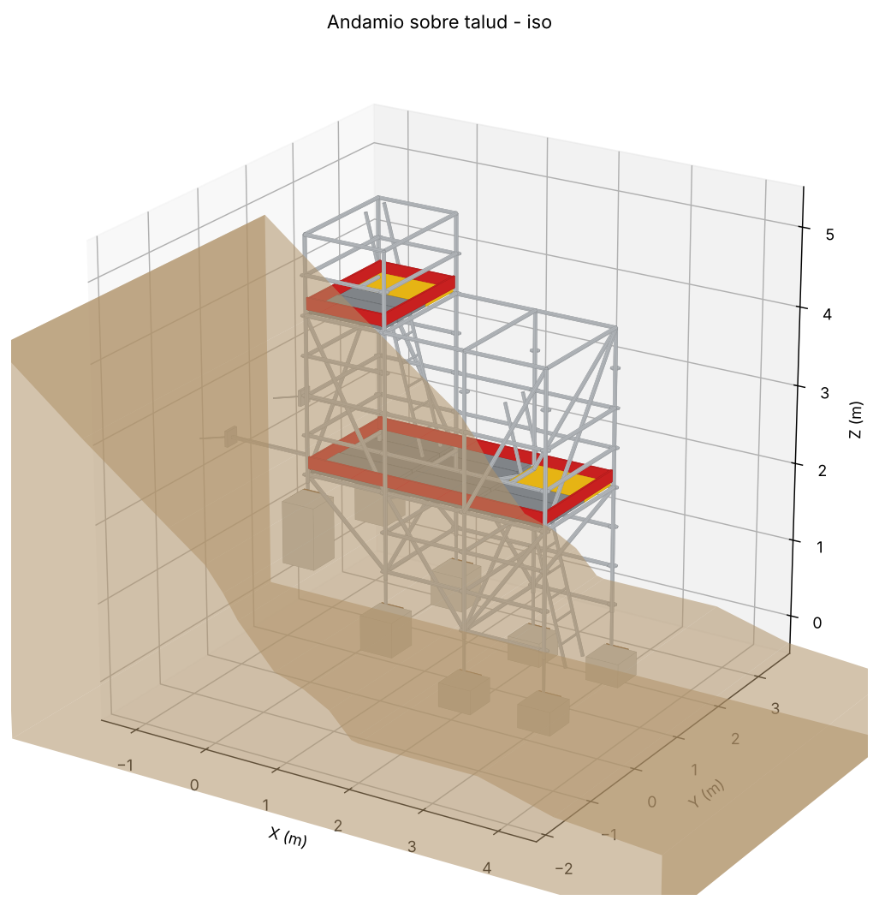
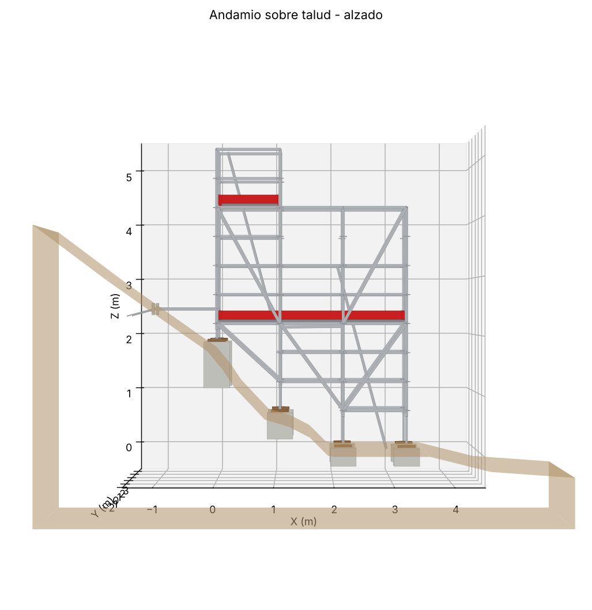

# Andamio multidireccional sobre talud — Revit (plantilla métrica)

Modelo paramétrico del plano **001-PA-AND-001**: andamio tipo *ringlock* con torre de 1.09 m
y plataforma de trabajo de 2.20 m, apoyado sobre un talud.



## Cómo generarlo en Revit

1. Crea un proyecto nuevo con la plantilla **métrica** (`DefaultMetric.rte` / *Plantilla de arquitectura*).
   El script además fija la unidad de longitud del proyecto en **metros (0.01)**.
2. Ejecuta el script con una de estas opciones:
   - **pyRevit**: copia la carpeta `AndamioTalud.extension` a tu carpeta de extensiones
     (`%APPDATA%\pyRevit\Extensions`) → *Reload* → pestaña **AndamioTalud → Modelado → Andamio Talud**.
   - **RevitPythonShell**: *Run script* → `AndamioTalud.extension/.../AndamioTalud.pushbutton/script.py`.
   - **Dynamo**: pega todo el contenido de `script.py` en un nodo *Python Script* y ejecuta.
3. Se crean niveles, materiales, el modelo 3D (DirectShape, categoría *Modelos genéricos*;
   el terreno como *Topografía* si la versión lo permite) y la vista **"3D - Andamio sobre talud"**.
   Si lo vuelves a ejecutar, reemplaza el modelo anterior (no duplica).

Cada pieza es un elemento independiente con su nombre en **Comentarios** y su grupo en **Marca**,
así puedes hacer tablas de planificación (metrado de montantes, largueros, plataformas, etc.).

## Datos del plano y criterios adoptados

| Elemento | Valor | Origen |
|---|---|---|
| Ancho de torre | 1.09 m | plano |
| Plataforma de trabajo | 2.20 m (2 vanos de 1.09 m) | plano |
| Altura torre sobre plataforma | 3.00 m (N+2.20 → N+5.20) | plano |
| Profundidad | 1.57 m (larguero normalizado) | criterio: estabilidad en talud |
| Plataforma superior | N+4.20 → gálibo libre 2.00 m sobre la plataforma de trabajo | criterio |
| Barandillas | intermedia +0.50 m, principal +1.00 m | criterio (norma) |
| Rodapiés | 0.15 m, rojo de seguridad | criterio / imagen |
| Montantes, largueros, diagonales | tubo Ø48.3 mm, rosetas cada 0.50 m | sistema multidireccional |
| Apoyos | dado de concreto nivelante + durmiente de madera + husillo regulable (≤0.50 m) | criterio: apoyo horizontal en pendiente |
| Arriostramiento | diagonales en "V" como en el alzado + diagonales transversales + diagonal en planta | plano + criterio |
| Amarre al talud | 2 tubos a N+2.45 con placa y anclaje químico | criterio |
| Accesos | escalera interior a 75° desde el pie del talud (entrada por el eje E4) y escalera de torre, ambas con plataforma-trampilla (amarilla) y 1.00 m de sobrepaso | criterio / imagen 3D |
| Paso torre ↔ plataforma | eje E2 libre de travesaños entre N+2.20 y N+4.20 | criterio de circulación |

Todas las cotas están al inicio de `script.py` (sección *PARÁMETROS DE DISEÑO*), en metros:
cambia ejes, niveles, perfil del talud o profundidad y vuelve a ejecutar.

## Vista previa sin Revit

```bash
pip install numpy matplotlib
python3 revit/herramientas/vista_previa.py salida/
```
Genera `andamio_talud.obj` (abre en cualquier visor 3D) y las imágenes de `preview/`.


